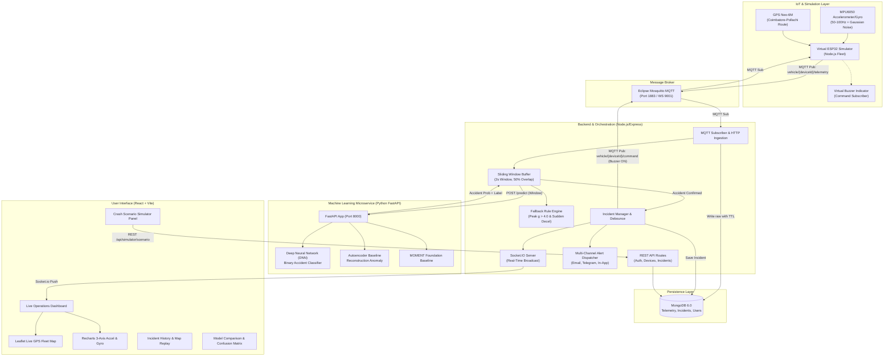
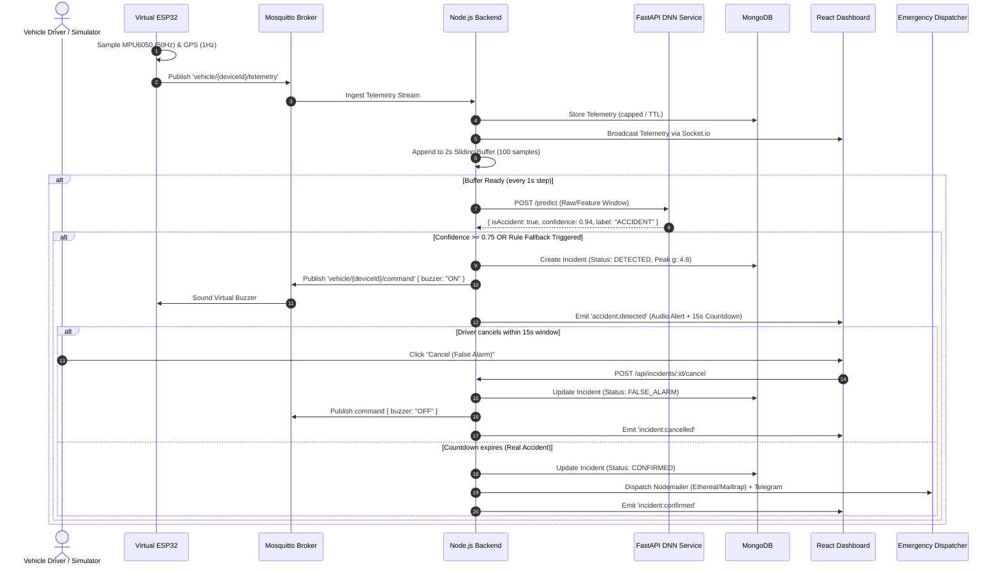

# IoT-Based Vehicle Accident Detection and Alert System
## System Architecture & Technical Specifications

### 1. High-Level Architecture

The system utilizes an event-driven IoT microservice architecture. Telemetry streams from virtual or physical vehicle IoT units via MQTT or HTTP fallback, undergoes sliding-window feature ingestion, evaluates inference via a Python Deep Neural Network (DNN) service, and broadcasts real-time telemetry and incident alerts to a modern React dashboard.

---

### 2. End-to-End Data Flow

---

### 3. Hardware-to-Simulation Mapping Table

| Physical IoT Component | Hardware Specification | Software Emulation Equivalent | Implementation Details |
| :--- | :--- | :--- | :--- |
| **Microcontroller** | ESP32-WROOM-32 (Dual-core 240MHz, Wi-Fi/BLE) | Node.js Multi-Vehicle Fleet Worker | `simulator/src/vehicle.js` & `fleet.js` Configurable vehicle instances, high-resolution drift-free 50Hz loop, per-vehicle MQTT client with Last-Will. |
| **Motion Sensor** | MPU-6050 6-DoF IMU (I2C, ±16g, ±2000°/s) | Physical 6-DoF Sensor Synthesizer | `simulator/src/sensors.js` (`MPU6050Sensor`) Generates 3-axis accel ($a_x, a_y, a_z$) in $g$ and gyro ($g_x, g_y, g_z$) in $^{\circ}$/s with gravity vector ($1.0g$), 16-bit ADC quantization (2048 LSB/g), saturation clipping, and speed-dependent noise $\mathcal{N}(0, \sigma^2)$. |
| **Location Sensor** | u-blox NEO-6M GPS Module (UART, 9600 baud, 1Hz NMEA) | Coordinate Waypoint Interpolator | `simulator/src/geo.js` & `sensors.js` (`GPSSensor`) Interpolates GPS coordinates across real-world Tamil Nadu routes (Coimbatore $\leftrightarrow$ Pollachi NH-83), calculating bearing, speed, 1.5m jitter, and 1Hz fix. |
| **Emergency Buzzer** | Active Piezo Buzzer 5V (GPIO23 output) | Virtual Buzzer Actuator | `simulator/src/buzzer.js` (`VirtualBuzzer`) Extends EventEmitter with `turnOn()` / `turnOff()`, 60-second auto-off timer, and listens to `vehicle/{deviceId}/command`. |
| **Driver Cancel Switch**| Momentary Push Button (GPIO 18 pull-up) | UI Cancel Button & Simulated CLI Trigger | `vehicle.cancelAlert()` Driver press emits `ALERT_CANCELLED` and clears buzzer/countdown. Also supports scheduled false-alarm demo (`--cancel-after`). |

---

### 4. MQTT Topic Architecture

| Topic Pattern | Direction | Payload Example / Schema | Description |
| :--- | :--- | :--- | :--- |
| `vehicle/{deviceId}/telemetry` | Simulator $\rightarrow$ Backend | `{"deviceId":"ESP32-SIM-001","ts":1710000000,"seq":101,"sampleRateHz":50,"accel":{"x":0.02,"y":0.01,"z":0.99},"gyro":{"x":0.1,"y":0.0,"z":-0.2},"gps":{"lat":10.998,"lng":76.966,"speed":52.4,"heading":184},"buzzer":"OFF","alert":{"pending":false,"remainingSec":0},"meta":{...}}` | High-frequency telemetry stream (50 Hz, QoS 0). |
| `vehicle/{deviceId}/event` | Simulator $\rightarrow$ Backend | `{"type":"IMPACT_DETECTED","deviceId":"ESP32-SIM-001","ts":1710000000,"peakG":8.4,"gps":{...}}` | Critical event notices (`IMPACT_DETECTED`, `ALERT_CONFIRMED`, `ALERT_CANCELLED`, `BUZZER_ON`, `BUZZER_OFF`) (QoS 1). |
| `vehicle/{deviceId}/status` | Simulator $\rightarrow$ Backend | `{"deviceId":"ESP32-SIM-001","online":true,"plate":"TN-37-AB-1234","route":"Pollachi - Coimbatore Corridor","sampleRateHz":50,"ts":1710000000}` | Connection state (Retained, QoS 1 with Last-Will offline payload). |
| `vehicle/{deviceId}/command` | Backend $\rightarrow$ Simulator | `{"buzzer":"ON"|"OFF"}` or `{"cmd":"CANCEL"}` or `{"cmd":"RESET"}` | Actuator commands triggering buzzer or cancelling/resetting incidents (QoS 1). |
| `simulator/control` | Control $\rightarrow$ Simulator | `{"id":"req-1","action":"trigger","deviceId":"1","scenario":"frontal_collision","cancelAfterSec":5}` | Global remote fleet orchestration (QoS 1). |
| `simulator/control/response` | Simulator $\rightarrow$ Control | `{"id":"req-1","success":true,"affected":["ESP32-SIM-001"],"scenario":"frontal_collision"}` | Remote command acknowledgment (QoS 1). |

